# Minimi

**Ask a real question. Get an answer that can show its sources, remember the context, and explain what changed.**

Minimi is a cited research and memory assistant built on **MINImi Harness**, our customized agent runtime. One model-callable tool (`web_search`), bounded parallel retrieval, dated SQLite memory, and a deterministic evidence digest sit behind a deliberately small chat surface.

[](https://minimi.sparetokens.tech/)
[](tests/)
[](evals/runs/REPORT.md)
[](package.json)

[Design](DESIGN.md) · [Architecture](architecture.md) · [Decisions and experiments](decisions.md) · [Evaluation results](evals/runs/REPORT.md) · [Deployment](deploy/README.md)

## Architecture at a glance

<a href="docs/architecture/minimi-harness.html"></a>

*Interactive artifact: [`docs/architecture/minimi-harness.html`](docs/architecture/minimi-harness.html) · vector source: [`minimi-harness.svg`](docs/architecture/minimi-harness.svg) · PNG fallback: [`minimi-harness.png`](docs/architecture/minimi-harness.png). The diagram was authored with Archify 1.1.0 and passed its validate, deliver, check, and browser-check gates.*

The interesting question is a follow-up: *“On Monday we shortlisted five CRM tools. Has anything changed since?”* Answering it requires the right historical conversation, fresh evidence about the same tools, and compatible terms before declaring a change. Minimi treats those as separate jobs instead of one giant prompt.

## What it does

| Capability | What happens |
| --- | --- |
| **Dated memory** | Prior turns, facts, and shortlist snapshots live in SQLite. Recall respects explicit dates, local calendar windows, and the active-turn exclusion. |
| **One tool only** | The model can call `web_search`; there is no model-facing shell, file writer, or subagent. Search budgets live in host code. |
| **Parallel evidence** | Up to three independent queries run together, selected pages are fetched, and a deterministic digest keeps claims plus source URLs under a 900-token evidence budget. |
| **Change checks** | A saved baseline and fresh observations are compared only when their billing basis, plan, and terms are compatible. |
| **Clickable answers** | The host supplies a citation ledger; the model cites `[S1](https://…)` inline and ends researched answers with a Sources list. |
| **Observable turns** | Every live turn emits LLM, memory-retrieval, and tool spans with input/output/cache tokens, estimated cost, and latency to LangSmith. |
| **Fresh hosted state** | The public demo is a shared owner profile with a temporary **Delete chat** action for clearing a conversation. |

## How a turn works

1. **Recall** — MINImi Harness selects relevant dated turns, facts, and snapshots from SQLite. The live trace records a `retriever.memory.recall` span containing the SQL statements, selected records, date window, and rendered-context size.
2. **Reason** — the model answers directly when no fresh evidence is needed, or calls `web_search` with up to three independent queries.
3. **Retrieve** — host code runs bounded parallel Search requests and selective Fetch calls. Provider attempts, retries, and budgets stay outside the model.
4. **Compress** — the evidence digest keeps claim-sized passages, source metadata, and gaps. It does not let the model invent missing values.
5. **Answer** — the model streams a cited answer. Change questions compare compatible saved and current observations rather than assuming a delta.
6. **Trace** — the turn is exported to LangSmith as `minimi.live.turn` with `retriever.memory.recall`, `llm.step.*`, and `tool.web_search` children.

Default limits are **3 queries per call**, **2 calls per turn**, and **12 provider attempts including retries**. The selected-evidence budget is **900 estimated tokens per batch**; report metadata is additional. These limits are enforced in server code.

## Quickstart

Requires **Node.js 24.9+** and a provider key with access to the configured chat and Search/Fetch services. Tested with Node **24.11.0**, npm **11.6.1**, and MINImi Harness **0.2.2-rc.1**.

```sh
git clone https://github.com/shipitdev/minimi-chatagent.git
cd minimi-chatagent
npm install
cp .env.example .env
```

Set `DEEPSEEK_API_KEY` in `.env`, then start:

```sh
npm run dev
```

Open the authenticated local URL printed by the launcher. The default port is **8787**. `npm run dev:no-open` starts without opening a browser. `DEEPSEEK_MODEL` defaults to `deepseek-flash`; the key stays server-side. Live conversations consume provider usage and are not an offline model demo.

All configuration placeholders live in [.env.example](.env.example). Application state lives in ignored `.dsh/` and `data/` directories; the default memory database is `data/minimi.db`.

### Public demo

**https://minimi.sparetokens.tech** runs on an Ubuntu VM behind a named Cloudflare Tunnel. The gateway and app listen on loopback only. The public profile is chat-only and currently includes a temporary **Delete chat** action. To hide that control before submission, set `DELETE_CHAT_BUTTON = false` in [client/lib/client.js](client/lib/client.js#L38), rebuild, and redeploy.

## What to try

- Ask an ordinary question or request a draft: the agent can answer without searching.
- Research a current fact and open the citations to inspect the sources.
- Return in a new session and ask about an earlier discussion or a supported calendar date.
- Revisit a saved shortlist and ask whether its prices, features, or recommendation still hold.
- Open a live trace and inspect the recall records, SQL, Search/Fetch timing, token counts, and cost.

Historical questions need actual prior records. An empty checkout cannot reconstruct a conversation it never stored. When the subject or comparison terms are unclear, the right response is clarification or an explicit evidence gap.

## Evaluation

| Command | What it runs | Provider calls |
| --- | --- | --- |
| `npm test` | Offline memory, date, digest, comparison, tool-boundary, gateway, observability, and client checks | None |
| `npm run test:e2e` | Browser conversations, citations, change view, and restart recall | Live model; live and fixture retrieval |
| `npm run test:headless` | Headless acceptance path | Live model |
| `npm run eval:golden:all` | Dev, holdout, and live golden splits through the evaluation adapter | Live model; live retrieval on the live split |
| `npm run eval:deepeval` | Component, pipeline, and workflow semantic checks | DeepSeek judge |
| `npm run observability` | Local turn-metric summary | None |

Current evidence:

- **25/25** offline checks pass.
- **64/64** golden-v2 cases answered; **62/64** pass every non-null structural check.
- **62/64** structural result is not full semantic correctness; the golden adapter runs its own model loop and routing policy.
- A **16-case** DeepEval sample scored **0.73** contextual recall, **0.98** faithfulness, **0.84** answer relevancy, and **0.63** workflow compliance (10/16 pass).
- The browser suites and public smoke checks have passed on the current deployment.

Golden evaluation requires Python 3.10+ and a separate eval environment; LangSmith/DeepEval setup is in [evals/README.md](evals/README.md). Read [evals/runs/REPORT.md](evals/runs/REPORT.md) and [decisions.md](decisions.md) before comparing scores.

## Observability

Live traces are available in **[minimi-live-azure-v2](https://smith.langchain.com/o/b0755f15-5c97-4053-8e80-456075377917/projects/p/ba2e4a76-fcbd-4083-983d-c75f04f08167)**.

Each trace carries:

- `retriever.memory.recall` — query, SQLite statements, date window, selected turns/facts/snapshots, counts, rendered-context size
- `llm.step.*` — prompt/completion/cache tokens, cost, latency, model metadata
- `tool.web_search` — queries, attempts, citations, duration
- turn-level route, latency, first committed answer time, model/tool calls, and estimated cost

The cost figure is an estimate from configured token prices, not a provider invoice. Local JSONL and per-turn JSON are written under `data/observability/`; `minichat-traces.service` uploads new turns to LangSmith.

## Project layout

```text
plugin/src/   MINImi Harness hooks, search, memory, evidence, comparisons, telemetry
client/       Web branding, theme, temporary chat deletion
profile/      Local, headless, and review profiles
scripts/      Build, startup, supervisor, gateway, and observability helpers
tests/        Offline checks and browser diagnostics
evals/        Golden-v2 cases, adapter, DeepEval, trace export, saved results
docs/         Design notes, evaluation review, deployment, architecture artifact
deploy/       Azure systemd units and operations
```

## Design documents

- [DESIGN.md](DESIGN.md) — the concise submission narrative
- [docs/engineering-design.md](docs/engineering-design.md) — full engineering rationale
- [architecture.md](architecture.md) — runtime and persistence flow
- [decisions.md](decisions.md) — measured experiments and tradeoffs
- [docs/challenge-chat-review.md](docs/challenge-chat-review.md) — challenge walkthrough and observed limits
- [deploy/README.md](deploy/README.md) — Azure/systemd operations

## Known limits

- The public deployment is a **shared owner profile**. Visitors share session history and memory; it is not a multi-user authorization boundary.
- Memory retrieval is keyword/date scoring, not embeddings. Ambiguous subjects and incomplete weekday phrasing can miss records.
- The golden adapter is not a full MINImi Harness browser replay. Its structural score is component evidence, not end-to-end answer correctness.
- Semantic DeepEval scores are sampled and judge-model dependent; low scores are not automatic proof that an answer is wrong.
- The temporary Delete chat control removes the current hosted chat and its memory data; LangSmith retains the external trace.
- Browser and GPU-dependent visual checks can be sandbox-sensitive.

## Credits and license

Minimi is a customized product built on the open-source **DeepSeek Harness** runtime; upstream license and notices are preserved in [docs/DSH-LICENSE](docs/DSH-LICENSE) and [NOTICE.md](NOTICE.md). This is the single upstream-runtime acknowledgment.

The architecture visual was generated with [Archify](https://github.com/tt-a1i/archify) 1.1.0 (Apache-2.0 skill; adapter installed from `@tt-a1i/archify-dsh`). Evaluation and tracing use LangSmith and DeepEval; provider usage is governed by the configured provider account.
