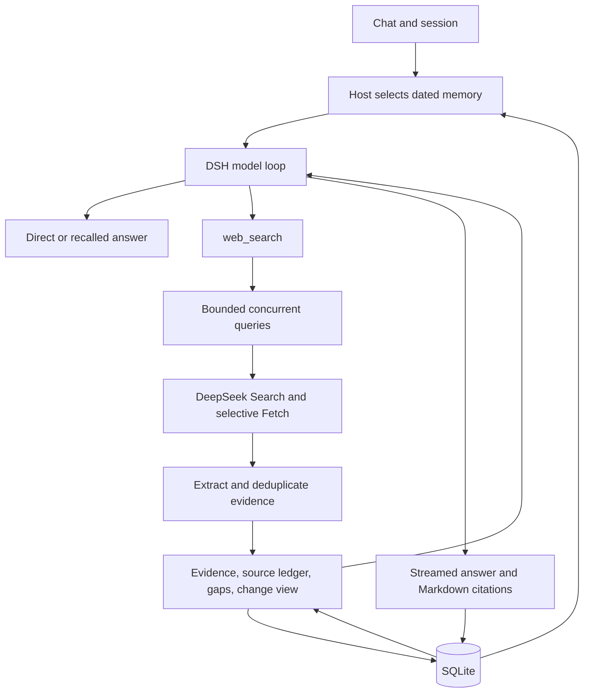

# Architecture

MiniChat is the DSH-based prototype described in [DESIGN.md](DESIGN.md). This document follows the implemented production path; the golden adapter is a separate evaluation path.

## Chat and dated memory

[scripts/dev.mjs](scripts/dev.mjs) loads server configuration, builds the plugin, and launches pinned DSH with the project profile. DSH owns sessions, streaming and the sole production model loop. [plugin/src/index.ts](plugin/src/index.ts) supplies runtime context and connects turn events to persistence. The UI retains DSH conversation rendering with a branded client and a small checked English-copy patch; upstream notices are preserved.

[MemoryStore](plugin/src/memory.ts) stores turns, facts, searches and subject snapshots in SQLite. The exact DSH session ID and turn number join host records to the upstream transcript. Instants are UTC epoch milliseconds; timezone-aware calendar conversion resolves supported dates before candidate ranking.

Recall considers the latest 400 turns, 600 facts and 100 snapshots. It filters a resolved date window, applies lexical relevance and recency ordering, and returns bounded selections (by default six turns, eight facts and four snapshots). It excludes the in-progress turn. Relevant assistant text can identify subjects mentioned in earlier answers.

Date filtering is conditional on the parser resolving a window. Explicit dates and common day/week/month phrases have coverage; the exact “last Tuesday” prompt returned no host date window in the saved diagnostic. The model resolved that date, but broader retrieved context allowed older-thread leakage. The draft's date-window description is the implemented mechanism, not a guarantee for every natural-language date. A current user's profile shares memory across sessions; there is no tenant isolation.

## One tool, parallel retrieval

The plugin registers `web_search`, disables stock tools and enforces budgets in host code. Search and Fetch are internal services, not separate model-callable tools. Ordinary conversation and dated recall can answer without provider search.

[Configuration](plugin/src/config.ts) defaults to three queries per call, concurrency three, two calls per turn, one change check, twelve actual provider attempts including retries, and 900 estimated evidence tokens per batch. The second call is instructed to target a gap, but host code enforces counts rather than semantic targeting.

[runSearchBatch](plugin/src/report.ts) uses bounded concurrent execution. [Search/Fetch](plugin/src/search.ts) call DeepSeek's tool endpoints; selective page fetch follows a change check, explicit hint or thin authoritative snippet. Fetch failures preserve available snippets. A query failure returns its gap while other queries retain their results. Search and Fetch retries share the attempt counter.

## Evidence and citations

[buildDigest](plugin/src/digest.ts) ranks readable clauses using relevance and explicit-value signals, associates them with subjects, removes duplicates and selects within the allocated budget. The batch divides its evidence budget across queries. Source metadata and report instructions are additional tokens.

The report assigns source IDs, URLs, retrieval dates and available publication dates to selected evidence. Its text includes per-query results, missing evidence, citation instructions and a copyable source ledger. Raw provider payloads do not enter model context. The model writes Markdown citations, and DSH renders clickable links. Browser checks verify final links belong to retrieved evidence; this is not a semantic entailment guarantee for every claim.

Compression is heuristic and lossy. Subject aliases and cross-sentence qualifiers can be discarded. A source containing a 100 GB quota and its calendar reset produced an answer missing the reset; semantic completeness must be checked alongside text size.

## Baselines and change checks

Before processing fresh evidence, the report reads a snapshot using the supplied subject key. [Billing comparisons](plugin/src/billing.ts) represent amount, currency, unit, period, commitment basis and seat minimum. Different terms are reported as non-comparable rather than an automatic price change. Non-price extracted facts can also enter comparison views.

Searches and facts are persisted with observation time. Snapshot writes require a subject and at least one extracted fact. Refreshed attributes replace matching attributes; other verified attributes and their citations are retained. A failed lookup does not erase its baseline. The snapshot is the latest merged observation, not a complete timeline of every intervening value.

The model's verbose subject string can differ from the canonical snapshot key; digest normalization is separate from lookup. The recorded browser diagnostic exposed missing baselines and dropped prices from this mismatch. Two equal observations establish equal observed values, not continuous stability.

## Observability and evaluation boundary

[Local telemetry](plugin/src/observability.ts) records turn/model/tool spans, duration, committed-answer timing, token/cache splits, attempts and configured cost estimates. [LangSmith export](evals/README.md) uploads golden and live traces with local fallback. Committed text is not streaming TTFT; tool citation count is not supported-claim count.

[evals/adapter.mjs](evals/adapter.mjs) imports product modules but uses its own Chat Completions loop, routing policy and live-page prefetch. Frozen-clock fixture replay is useful component evidence, not a production DSH replay. [Browser tests](tests/e2e.mjs) exercise DSH with the live model and a mix of live and fixture retrieval. [Decisions](decisions.md) records the measurements and remaining comparisons.

The public demo runs on an Ubuntu VM with systemd services for the backend/gateway, Cloudflare Tunnel and live trace export. Both application listeners remain loopback-only. See [deployment](deploy/README.md). The gateway still shares an owner profile; visitor isolation and server authorization need further work before broader hosting.
