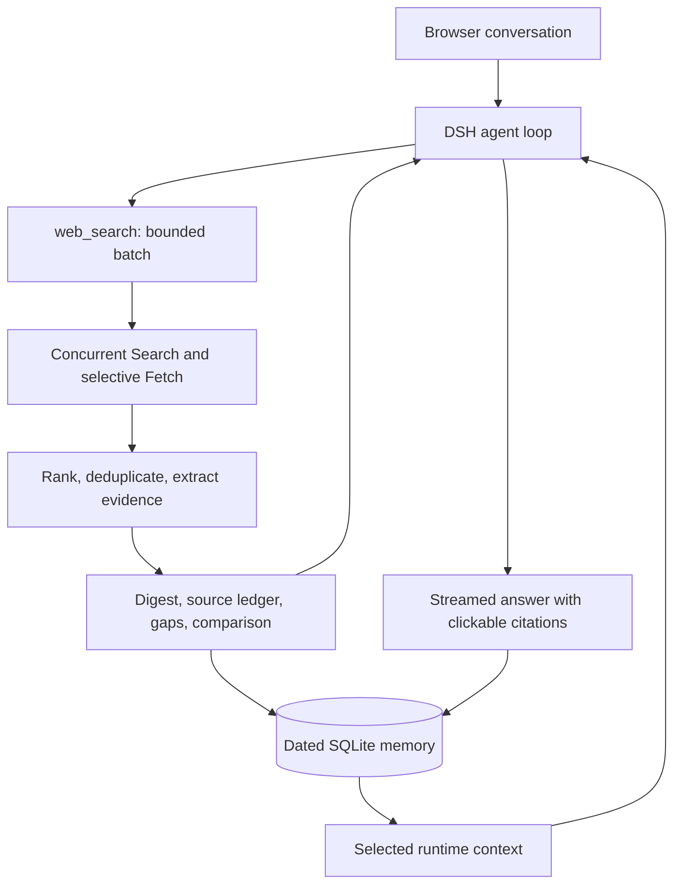

# Minimi: research that remembers its evidence

Minimi is a conversational research assistant built around a question ordinary search does not answer well: **“What did we decide last time, and does it still hold?”**

Answering requires more than a relevant page. The system must recover the correct conversation, interpret its date, find fresh evidence about the same subject, and distinguish an actual change from a difference in terms. Our engineering focuses on that chain: bounded research, compact evidence with provenance, and durable, dated memory.

DeepSeek Harness (DSH) provides the agent loop and browser interface. Minimi contributes the host plugin and its search, compression, recall, comparison, and evaluation pipeline. Root npm commands launch the local application; the temporary competition demo exposes it through a Cloudflare Tunnel.

## Engineering at a glance

| Decision | Reason | Implementation / evidence |
| --- | --- | --- |
| One DSH loop; one model-callable tool | Keep execution ownership and the action space explicit | [Plugin registration and hooks](../plugin/src/index.ts), runtime tool-boundary checks |
| Parallel research with server-enforced budgets | Overlap independent lookups without unbounded retries | [Search](../plugin/src/search.ts), [batch/report pipeline](../plugin/src/report.ts), attempt-accounting tests |
| Extractive evidence compression | Reduce irrelevant context while retaining auditable claims | [Digest](../plugin/src/digest.ts), [size experiment](../tests/digest-bench.ts) |
| Dated SQLite records and snapshots | Recover earlier observations after restart | [Memory](../plugin/src/memory.ts), [date resolution](../plugin/src/time.ts), restart/date tests |
| Typed comparison rules | Equal numbers can describe different offers | [Billing terms](../plugin/src/billing.ts), partial-refresh and qualifier tests |
| Layered evaluation and local traces | Separate structural behavior, semantic quality, and browser integration | [Golden suite](../evals/golden-v2/README.md), [DeepEval](../evals/deepeval/run_deepeval.py), [run report](../evals/runs/REPORT.md) |

Recorded evaluation: **64/64 golden cases answered; 62/64 pass all applicable structural checks.** A separate 16-case DeepEval sample passes **10/16 workflow checks**. These measure different things: selecting a source or history record does not establish that every required fact reached the answer. That distinction guides our next fixes.

## 1. One agent loop, an explicit host contract



DSH owns model calls, sessions, tool dispatch, and streaming. Minimi supplies context and exposes `web_search`; Search and Fetch remain server-side services behind that interface. Recall is supplied by host code rather than offered as another model tool. Ordinary chat can answer directly, dated recall can use stored context, and fresh research can invoke the tool.

The plugin disables stock tools and records visible schemas and disabled-tool probes. Budgets live in server code, so a prompt cannot authorize additional provider attempts. The production profile introduces no second planner or agent loop.

DSH is pinned to **0.2.2-rc.1**. Branding uses client hooks and theme tokens; three English conversation strings require a checked, idempotent build patch. We do not patch the server's agent loop. Upstream notices remain in [NOTICE.md](../NOTICE.md).

## 2. Research is a bounded batch

Independent questions run concurrently. A second tool call is available for a remaining evidence gap; host code limits its count, while the instruction to make it targeted remains model policy.

| Default production limit | Value |
| --- | ---: |
| Queries in one call | 3 |
| Search concurrency | 3 |
| Tool calls per turn | 2 |
| Change-check calls per turn | 1 |
| Search/Fetch attempts, including retries | 12 |
| Selected evidence budget per batch | 900 estimated tokens |

The evidence budget excludes metadata, instructions, and the budget footer. [Configuration](../plugin/src/config.ts) makes the defaults inspectable.

`web_search` combines DeepSeek Search (`/v1/tools/search`) with selective DeepSeek Fetch (`/v1/tools/fetch`). A change check, explicit fetch hint, or thin authoritative snippet can justify a page fetch. Fetching is bounded to one page per query, and its text enters the same evidence pipeline as snippets. Raw provider payloads stay out of model context and the chat UI.

Search/Fetch use `MINIMI_SEARCH_BASE_URL`, defaulting to `https://api.deepseek.com`; DSH's Messages adapter uses `https://api.deepseek.com/anthropic`. Both use the server-side platform key.

Failures are isolated by query. A timed-out vendor should not erase a supported answer for another vendor. Failed retries consume the shared attempt budget. A fixture backend exercises the product contract for deterministic failure and concurrency tests.

The tradeoff is explicit: bounded research may leave a gap. The tool returns that gap instead of continuing an invisible research loop indefinitely.

## 3. Compression must preserve what makes a claim true

A short excerpt is useful only if it still supports the decision. “$21 per seat per month, annual commitment, minimum 20 seats” cannot safely become “$21/month.” A quota without its reset period may also be insufficient to answer the question.

Our digest uses **deterministic, readable text extraction**: rank clauses for relevance and explicit values, associate them with subjects, deduplicate, and select evidence within a budget. Facts retain source references; the report carries URLs, retrieval timestamps, available publication dates, and missing-evidence markers. The final answer can render clickable citations with inspectable origins.

This is **Coca-Cola-inspired**, not the paper's trained latent compressor. We adopted the engineering objective of retaining useful evidence under a context budget; we do not claim reproduction of its algorithm or benchmark results. ReWOO similarly informs independent lookup batching rather than supplying a separate planner implementation.

An offline replay of recorded research excerpts measured these text-size reductions using our character-based token estimator:

| Input results | Digest-only reduction | Full tool-text reduction |
| --- | ---: | ---: |
| 3 | 61.3% | 30.0% |
| 6 | 83.0% | 60.2% |
| 8 | 87.1% | 68.9% |

The columns use different baselines: raw excerpts for the digest; raw JSON for full tool text. The latter includes report metadata and the source ledger, but excludes DSH context, runtime wrappers, and the final budget footer. These are size measurements on one recorded corpus, not measured quality improvements, billed savings, or end-to-end speedups. See [benchmark implementation](../tests/digest-bench.ts) and [measurement details](../CHANGELOG.md).

Semantic evaluation exposes the tradeoff. Saved cases reject available price evidence because subject matching is too restrictive; another retains a 100 GB quota but loses its linked calendar-month reset clause. These are actionable completeness failures. A smaller digest is not a success if it removes a required qualifier.

## 4. Memory stores observations with dates and provenance

SQLite persists turns, extracted facts, searches, and shortlist snapshots, linked to DSH's exact session ID and turn number. UTC timestamps preserve ordering; the conversation's timezone supplies calendar semantics for “yesterday” and “last week.” Date-window tests include daylight-saving transitions and explicit dates.

Recall uses lexical relevance and time filtering over bounded candidates: the latest 400 turns, with separate fact and snapshot selection. Selected records enter runtime context instead of replaying the entire database. This keeps the mechanism local, inspectable, and inexpensive. The tradeoff is limited semantic matching and a bounded historical horizon; this is not an embedding memory system.

LongMemEval informs the test categories—dated recall, knowledge updates, and uncertainty—but is neither an installed memory engine nor a benchmark result we claim.

Change checks pair a saved observation with fresh evidence about the same subject. Comparison preserves relevant region, tier, version, units, and billing terms. For pricing, [typed terms](../plugin/src/billing.ts) distinguish amount, currency, unit, period, commitment basis, and seat minimum. An annually committed per-seat offer and a monthly flat price are not interchangeable observations.

If a refresh supplies only some attributes, persistence preserves previous verified values for missing attributes. If terms are incompatible or evidence is absent, the report explains the limitation rather than declaring a change. Two equal dated observations also do not prove there was no intervening change.

Snapshot creation requires a supplied subject and usable extracted facts. Durable turn storage alone therefore does not guarantee every research turn creates a comparison baseline. The complete research → restart → recall → refresh journey needs integration evidence of its own.

The current profile is a **single-user prototype**: sessions share recall. Persistence and cross-session recall do not provide multi-user isolation.

## 5. A curated dataset makes behavior testable

We carried a curated golden dataset into this workspace and integrated it with the product modules. Synthetic conversations and evidence encode explicit success criteria, required sources, and forbidden claims. The suite is inspired by public product/challenge materials; it is not the organizers' private test set.

V2 preserves 32 original cases and adds 16 scenarios in two wordings each. Paired prompts share history, evidence, and rubric: one is explicit; the other uses casual language and contextual references. This tests whether behavior survives phrasing changes. Pair variants are correlated, so 64 prompts are not 64 independent scenarios.

| Split | Cases | Purpose |
| --- | ---: | --- |
| Dev | 18 | Iterate on routing, dates, evidence selection, and abstention |
| Holdout | 40 | Exercise similar threads, corrections, restart, conflicting sources, and partial failure |
| Live | 6 | Read current public sources with real provider calls |

Replay uses fixed clocks, explicit timezones, imported histories, and synthetic search fixtures. Gold criteria stay out of answering-model prompts. Replay uses the live answering model with fixture retrieval; live cases use real Search/Fetch as well. Construction and grading rules are in the [golden README](../evals/golden-v2/README.md).

### Three evaluation layers

| Layer | Checks | Saved result |
| --- | --- | --- |
| Structural | History selection, search behavior, expected-source presence, entity coverage | 62/64 whole-case passes; 64/64 answered |
| Semantic components/pipeline | DeepEval contextual recall, faithfulness, answer relevancy | Mean scores 0.7292 / 0.9762 / 0.8433 across available metric samples |
| Workflow | GEval against case criteria and forbidden claims | 10/16 sampled cases pass at the configured 0.5 threshold |

The structural run used 154,168 input and 14,613 output tokens, with a configured model-cost estimate of approximately **$0.0188**. This is adapter answering-model accounting, not a complete service/judge bill. Per-case reasons and coverage are in the [run report](../evals/runs/REPORT.md) and [DeepEval summary](../evals/runs/deepeval-summary.json).

The adapter reuses memory, search-batch, digest, billing, date, and prompt modules, but runs a separate Chat Completions loop. It uses forced initial routing, extra research instructions, and official-page prefetch for live cases. Results validate components under that harness; they do not establish autonomous routing accuracy or identical DSH browser performance. Browser integration is tested separately by [local](../tests/e2e.mjs) and [public](../tests/public.mjs) suites.

The DeepEval sample is diagnostic rather than a population estimate. Some judge contexts omit dated metadata or prior evidence visible to the answering model, so reasons need transcript review. High faithfulness alongside lower workflow compliance suggests that avoiding unsupported claims is easier than preserving all required information. Inspected holdout cases are now exposed; future tuning needs fresh confirmation cases.

## 6. Traces locate failures within the pipeline

The live [observability sink](../plugin/src/observability.ts) records per-turn JSONL and trace files: duration, committed-answer timing, model/tool spans, token/cache splits, estimated cost, provider attempts, and citation counts. Writes are best-effort so telemetry does not become a dependency for answering.

The saved 28-turn public-app aggregate has **3.385 s p50 / 14.138 s p95** total duration. This is a small mixture of workloads, not a load benchmark. First committed answer text is recorded separately; it is not streaming time to first token. Citation counts describe tool output, not independently verified claim support.

Evaluation produces 64 local trace trees with memory, model, and tool spans. LangSmith is now integrated: the corrected key uploaded the 64 golden traces, a 64-example golden dataset, and 38 DeepEval feedback scores; the public runner supervises a live-turn exporter to the `minimi-live-azure-v2` project. Panel URLs are in [evals/README.md](../evals/README.md), and local traces remain available without the external service.

The next useful measurements are route-specific latency, full tool-envelope tokens, retained qualifiers, snapshot creation, and supported final claims. They explain failures more directly than one aggregate score.

## 7. Reproduction and acceptance

Tested runtime: **Node 24.11.0**, npm 11.6.1, DSH 0.2.2-rc.1. Minimum declared Node: 24.9.0 for the SQLite API used here.

```sh
npm install
cp .env.example .env
# Set the server-side provider key in .env.
npm run dev
npm test
```

The launcher configures the project-local DSH profile and prints the local URL. No global DSH installation is required. [README.md](../README.md) covers setup and browser checks. [evals/README.md](../evals/README.md) covers evaluations; the current DeepEval command depends on a sibling Python environment and is not yet self-contained in a clean checkout.

The acceptance contract remains:

| Conversation / boundary | Passing behavior |
| --- | --- |
| Clean install | Root npm commands launch the intended profile and browser UI |
| Everyday chat and planning | Contextual, streamed answer with no provider search |
| Current facts | Bounded research; cited sources support the answer, including non-pricing topics |
| Follow-ups and ambiguity | Resolve the intended subjects; clarify a genuinely ambiguous reference |
| Recall and change | Recover dated facts after restart; compare compatible fresh observations |
| Partial evidence and interruption | Preserve supported portions and readable text; retry targets the original turn without duplication |
| Tool boundary | Only web_search is model-callable; disabled tools are rejected |

Recorded checks include offline date/recall/comparison/budget tests, live browser chat/search/citations, and restart/new-session recall. [CHANGELOG.md](../CHANGELOG.md) records exact runs and live/fixture distinctions. Forced stream-drop/retry coverage, full production-DSH golden replay, and paired same-model comparison against the legacy app remain open acceptance work. The [design document](../DESIGN.md) preserves the current product specification.

The public demo is temporary and laptop-hosted. Its gateway currently shares the DSH owner profile; UI-hidden administrative controls are not a server authorization boundary. Broader use requires visitor isolation, restricted backend access, and aggregate usage limits. This deployment is not a multi-tenant production design.

## References

- [ReWOO](https://arxiv.org/abs/2305.18323): independent lookup planning as a design influence.
- [Coca-Cola](https://arxiv.org/abs/2611.06500): compression research motivating the evidence-budget experiment; our implementation is extractive text selection.
- [LongMemEval](https://arxiv.org/abs/2410.10813): motivation for separate memory capability tests.
- [Anthropic: Writing effective tools for agents](https://www.anthropic.com/research/writing-tools-for-agents): tool contracts, meaningful responses, and evaluation-driven iteration.
- [Anthropic: Effective context engineering for AI agents](https://www.anthropic.com/research/effective-context-engineering-for-ai-agents): context selection as a recurring systems problem.
- [Anthropic: Demystifying evals for AI agents](https://www.anthropic.com/research/demystifying-evals-for-ai-agents): distinguish tasks, traces, outcomes, and graders.

References motivate the choices; linked source and run artifacts establish what this prototype does.
